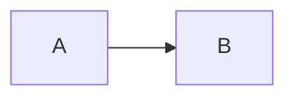

# Design note: <title>

**Status:** draft | accepted | superseded  ·  **Author:** <name>  ·  **Date:** <yyyy-mm-dd>

## Context
What problem, for whom, and why now. Link the ticket.

## Options considered
| Option | Pros | Cons |
|---|---|---|
| A | | |
| B | | |

## Decision
Which option and the one-sentence reason.

## Design

## Security & privacy
Output of the `threat-model` skill: top risks and their mitigations/tests.

## Test plan
Which tests prove this works and stays working.

## Rollout & rollback
Feature flag? Migration? How do we undo it?
